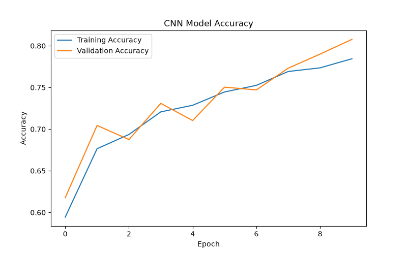
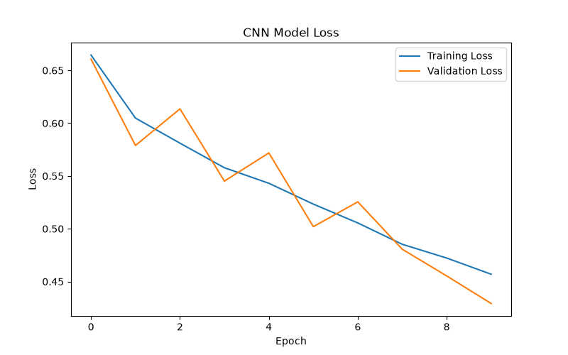

# Cat and Dog Image Recognition using CNN

## 1. Project Description

This project is a Deep Learning-based image classification system that predicts whether an input image contains a cat or a dog. It uses a Convolutional Neural Network (CNN) built with TensorFlow and Keras.

## 2. Project Objective

- Build and train a CNN model to classify images into two classes: **Cats** and **Dogs**.
- Evaluate the model performance on unseen test data.
- Predict the class of individual input images.

## 3. Technologies and Libraries

- **Python** – Programming language
- **PyCharm** – IDE
- **TensorFlow & Keras** – Deep Learning model building, training, and evaluation
- **Matplotlib** – Plotting training graphs
- **NumPy** – Image array processing

## 4. Installation

Install the required packages in the PyCharm terminal:

```bash
  python -m pip install -r requirements.txt
```

Verify TensorFlow installation:

```bash
  python -m pip show tensorflow
```

## 5. Dataset

This project uses the [Dogs vs. Cats Dataset](https://kaggle.com) from Kaggle.

### Dataset Distribution

| Split | Cats | Dogs | Total |
|---|---:|---:|---:|
| Training | 800 | 800 | 1600 |
| Validation | 200 | 200 | 400 |
| Testing | 100 | 100 | 200 |
| **Total** | **1100** | **1100** | **2200** |


## 6. Training Results

### Accuracy Graph



### Loss Graph



### Test Evaluation

| Metric | Result |
|---|---:|
| Test Accuracy | 79.85% |
| Test Loss | 0.4252 |

## 7. Folder Structure

```text
Cat_Dog_Image_Recognition/
├── dataset/
│   ├── train/ (cats, dogs)
│   ├── validation/ (cats, dogs)
│   └── test/ (cats, dogs)
├── test_images/
├── Cat_Dog_Image_Recognition.py
├── train_model.py
├── evaluate.py
├── predict.py
├── cat_dog_cnn.keras
├── best_cat_dog_model.keras
├── accuracy_graph.png
├── loss_graph.png
├── requirements.txt
└── README.md
```

## 8. How to Run the Project

1. Clone or download the repository and open it in PyCharm.
2. Install dependencies:

```bash
  python -m pip install -r requirements.txt
```

3. Download the dataset from Kaggle, set paths in `Cat_Dog_Image_Recognition.py`, and run:

```bash
  python Cat_Dog_Image_Recognition.py
```

4. Train the model:

```bash
  python train_model.py
```

5. Evaluate the model:

```bash
  python evaluate.py
```

6. Add an image to `test_images/`, update the path in `predict.py`, and run:

```bash
  python predict.py
```

## 9. Conclusion

This project successfully demonstrates binary image classification using a CNN with TensorFlow and Keras, achieving **79.85% accuracy** on the test dataset.
